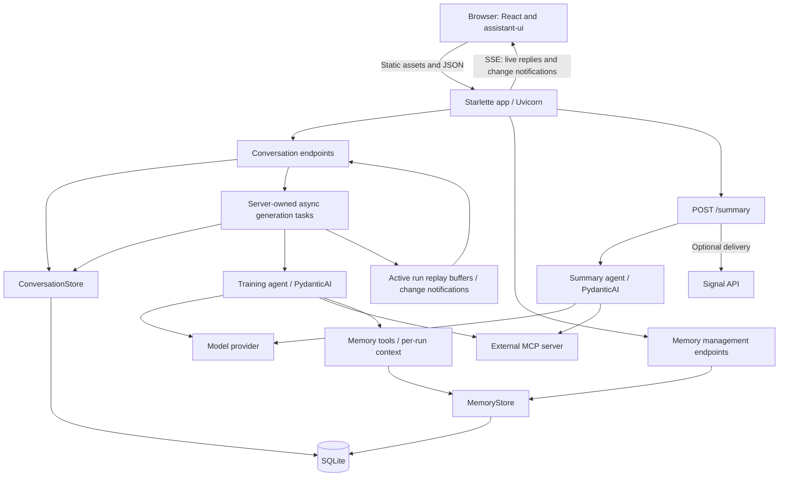
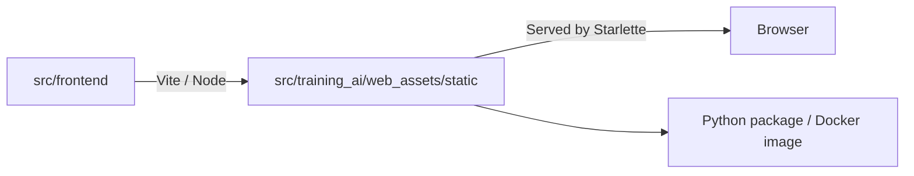

# Application components

## Runtime

| Component | Responsibility | Source |
| --- | --- | --- |
| Web entry point | Load configuration, create agents, register routes, serve built UI | [web.py](../src/training_ai/web.py) |
| Conversation API | Validate requests, call store commands/queries, own generation tasks and recovery | [conversation_api.py](../src/training_ai/conversation_api.py) |
| Conversation store | SQLite commands/queries, transactions, ordered history, run state and process lock | [conversation_store.py](../src/training_ai/conversation_store.py) |
| Database migrations | Shared append-only schema/data migrations, atomic upgrades and version checks | [database_migrations.py](../src/training_ai/database_migrations.py) |
| Upgrade backup | Checked SQLite backup under the ownership lock before Kubernetes upgrades | [database_backup.py](../src/training_ai/database_backup.py) |
| Live events | Replay active runs, notify connected browsers, send heartbeat comments | [conversation_events.py](../src/training_ai/conversation_events.py) |
| Training agent | Model instructions and tools from the external MCP server | [training_agent.py](../src/training_ai/training_agent.py) |
| Shared memory | Validated observations/goals/constraints, versioned commands, source links and receipts | [memory_models.py](../src/training_ai/memory_models.py), [memory_store.py](../src/training_ai/memory_store.py) |
| Memory agent integration | Per-run dependencies, sequential memory tools and fixed turn instructions | [memory_tools.py](../src/training_ai/memory_tools.py) |
| Memory context | Atomic turn selection, independent budgets and current reference resolution | [memory_context.py](../src/training_ai/memory_context.py) |
| Memory management | HTTP inspection/edit/forget commands and responsive browser view | [memory_api.py](../src/training_ai/memory_api.py), [memory.tsx](../src/frontend/memory.tsx) |
| Frontend | Thread selection, SSE subscriptions, assistant-ui runtime, Markdown/tool rendering and timestamps | [main.tsx](../src/frontend/main.tsx) |
| Frontend API helper | JSON requests and typed HTTP errors | [api.ts](../src/frontend/api.ts) |
| Stream reader | AI SDK SSE parsing, Vercel protocol assembly and mapping to assistant-ui messages | [stream.ts](../src/frontend/stream.ts) |
| Summary path | Date-window validation, summary generation and optional Signal delivery | [summary_api.py](../src/training_ai/summary_api.py), [summary_agent.py](../src/training_ai/summary_agent.py), [signal_sender.py](../src/training_ai/signal_sender.py) |

## Build and serving

The training agent adds fresh server date/time instructions to every model request, including
continued conversations and retries. `TIMEZONE` selects the user's IANA timezone (default
`UTC`), independent of the container's timezone.
The context includes the UTC offset,
weekday, and explicit dates for today, yesterday, and tomorrow. It is added alongside any
`BASE_INSTRUCTIONS` override. Invalid timezone configuration fails at startup. Summary requests
continue to use their own explicit `timezone` and date ranges.

- `make run-web`: build UI once, then start Uvicorn with reload on port **7932**, serving the
  built assets as production does.
- `make dev-web`: Vite dev server with hot module reload on port **5173**, proxying `/api` and
  `/summary` to Uvicorn with reload on port 7932. Override the server port with `WEB_PORT`.
- `make build-web`: build static UI assets; `make build`: also package Python and assets.
- Node is build tooling. The application server is Python; no Assistant Cloud integration.
- Local access has no application login. Deployment manifests apply Basic Auth at the ingress.
- Optional Logfire instrumentation is configured by the Python entry points.
- On narrow screens, navigation opens in a modal drawer; thread actions use a compact popover.
- Uvicorn allows five seconds for graceful shutdown before cancelling open SSE connections.

See [data model](data-model.md) and [frontend communication](frontend-backend.md).
See [Kubernetes deployment](kubernetes-deployment.md) for storage, backups, and rollout recovery.
See [shared training memory](shared-training-memory.md) for cross-thread context and evaluation.
