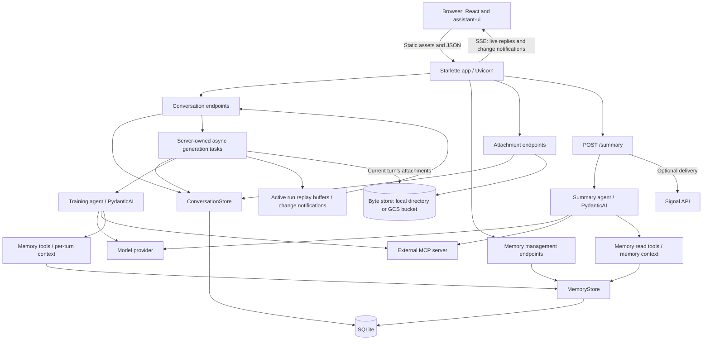
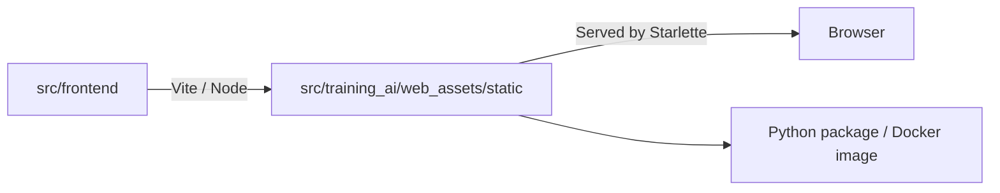

# Application components

## Runtime

| Component | Responsibility | Source |
| --- | --- | --- |
| Application factory | Build the Starlette app from a `Config`: create agents, register routes, serve built UI, expose agents on `app.state` for tests | [app.py](../src/training_ai/app.py) |
| Web entry point | Load configuration from the environment and expose the ASGI `app` for Uvicorn | [web.py](../src/training_ai/web.py) |
| Configuration | Parse and validate environment variables into a `Config` | [config.py](../src/training_ai/config.py) |
| Conversation API | Validate requests, call store commands/queries, own generation tasks and recovery | [conversation_api.py](../src/training_ai/conversation_api.py) |
| Conversation store | SQLite commands/queries, transactions, ordered history, run state and process lock | [conversation_store.py](../src/training_ai/conversation_store.py) |
| Database migrations | Shared append-only schema/data migrations, atomic upgrades and version checks | [database_migrations.py](../src/training_ai/database_migrations.py) |
| Upgrade backup | Checked SQLite backup under the ownership lock before Kubernetes upgrades | [database_backup.py](../src/training_ai/database_backup.py) |
| Chat attachments | Upload validation, download and removal endpoints; metadata queries; placeholders and content parts for model requests | [attachment_api.py](../src/training_ai/attachment_api.py), [attachments.py](../src/training_ai/attachments.py) |
| Attachment byte store | Content-addressed bytes on local disk or in a private Google Cloud Storage bucket, chosen at startup | [attachment_store.py](../src/training_ai/attachment_store.py) |
| Live events | Replay active runs, notify connected browsers, send heartbeat comments | [conversation_events.py](../src/training_ai/conversation_events.py) |
| Training agent | Model instructions and tools from the external MCP server | [training_agent.py](../src/training_ai/training_agent.py) |
| Shared memory | Validated observations/goals/constraints, versioned commands, source links and receipts | [memory_models.py](../src/training_ai/memory_models.py), [memory_store.py](../src/training_ai/memory_store.py) |
| Memory agent integration | Read tools and instructions for any agent; write tools, turn instructions and deps for the conversation agent | [memory_tools.py](../src/training_ai/memory_tools.py) |
| Memory context | Thread-independent selection from one snapshot: required memory and recent observations under their budgets | [memory_context.py](../src/training_ai/memory_context.py) |
| Conversation context | Once-per-turn preparation: memory context plus retry receipts and bounded history with current revisions or withdrawal notices | [conversation_context.py](../src/training_ai/conversation_context.py) |
| Memory management | HTTP inspection/edit/forget commands and responsive browser view | [memory_api.py](../src/training_ai/memory_api.py), [memory.tsx](../src/frontend/memory.tsx) |
| Frontend | Thread selection, SSE subscriptions, external-store runtime and thread-list adapter, run failure/retry and memory notices | [main.tsx](../src/frontend/main.tsx) |
| UI components | shadcn/ui (Base UI, `base-nova`) and assistant-ui elements copied into the repo and edited locally: Thread (Enter adds a new line), thread list sidebar, tool group/fallback, Markdown text, error and connection state, thinking indicator; the Memory dialog uses shadcn Dialog, Field, NativeSelect, Item, Alert and Collapsible | [components/](../src/frontend/components/), [components.json](../components.json) |
| Attachment adapter | Uploads composer files on pick, deletes removed uploads, maps chips to uploaded ids; sent attachments render with `MessageAttachments` | [attachments.ts](../src/frontend/attachments.ts), [message-attachment.tsx](../src/frontend/components/assistant-ui/elements/message-attachment.tsx) |
| Frontend API helper | JSON requests and typed HTTP errors | [api.ts](../src/frontend/api.ts) |
| Stream reader | AI SDK SSE parsing, Vercel protocol assembly and mapping to assistant-ui messages | [stream.ts](../src/frontend/stream.ts) |
| Summary path | Date-window validation, read-only memory context, summary generation and optional Signal delivery | [summary_api.py](../src/training_ai/summary_api.py), [summary_agent.py](../src/training_ai/summary_agent.py), [signal_sender.py](../src/training_ai/signal_sender.py) |

## Build and serving

The training agent adds fresh server date/time instructions to every model request, including
continued conversations and retries. `TIMEZONE` selects the user's IANA timezone (default
`UTC`), independent of the container's timezone.
The context includes the UTC offset,
weekday, and explicit dates for today, yesterday, and tomorrow. It is added alongside any
`BASE_INSTRUCTIONS` override. Invalid timezone configuration fails at startup. Summary requests
continue to use their own explicit `timezone` and date ranges.

- `make run-web`: build UI once, then start Uvicorn with reload on port **7932**, serving the
  built assets as production does.
- `make dev-web`: Vite dev server with hot module reload on port **5173**, proxying `/api` and
  `/summary` to Uvicorn with reload on port 7932. Override the server port with `WEB_PORT`.
- `make build-web`: build static UI assets; `make build`: also package Python and assets.
- Node is build tooling. The application server is Python; no Assistant Cloud integration.
- Local access has no application login. Deployment manifests apply Basic Auth at the ingress.
- Optional Logfire instrumentation is configured by the application factory.
- On narrow screens, navigation opens in a modal drawer; thread actions use a compact popover.
- Uvicorn allows five seconds for graceful shutdown before cancelling open SSE connections.

## Chat attachments

Attachment bytes are addressed by SHA-256 under `<sha[0:2]>/<sha>` in one of two stores,
chosen at startup in `create_byte_store`:

| Setting | Store |
| --- | --- |
| `ATTACHMENT_BUCKET` set | Private Google Cloud Storage bucket, optional `ATTACHMENT_PREFIX`. Writes use a "create only if absent" precondition and set the object's content type to the detected media type. Credentials come from Application Default Credentials (Workload Identity in GKE). |
| Otherwise | `ATTACHMENT_DIR`, default `attachments/` next to `DATABASE_PATH`. Writes go to `.tmp/` and are renamed into place; `.tmp/` is cleared at startup. |

Both are small synchronous classes with `put` and `open`, called in a worker thread. Bytes are
written before the metadata row commits. An unreachable bucket logs a warning at startup;
uploads, downloads and runs that need attachment content then fail with a storage error while
text-only chat keeps working.

How attachments reach the model:

- Stored user messages keep only their text. Attachment membership lives in SQLite.
- The current turn, on send and on retry, gets one extra prompt part with a label and the bytes
  of each attachment: images as image content, PDFs as document content. Empty text is omitted.
- Earlier turns replayed as history get a placeholder part instead, for example
  `[Attachment a1b2…: week-plan.pdf, application/pdf, 2.1 MB]`. Placeholders count toward
  `CONVERSATION_HISTORY_BUDGET` by their own length. The current turn's content is not part of
  that budget.
- Messages a run saves never contain bytes; echoed attachment content would be dropped before
  saving.

`make test-integration` runs the `integration`-marked tests, currently the bucket store, against
a local `fake-gcs-server` container. It needs Docker and no cloud access; `make test` skips them.

See [data model](data-model.md) and [frontend communication](frontend-backend.md).
See [Kubernetes deployment](kubernetes-deployment.md) for storage, backups, and rollout recovery.
See [shared training memory](shared-training-memory.md) for cross-thread context and evaluation.
