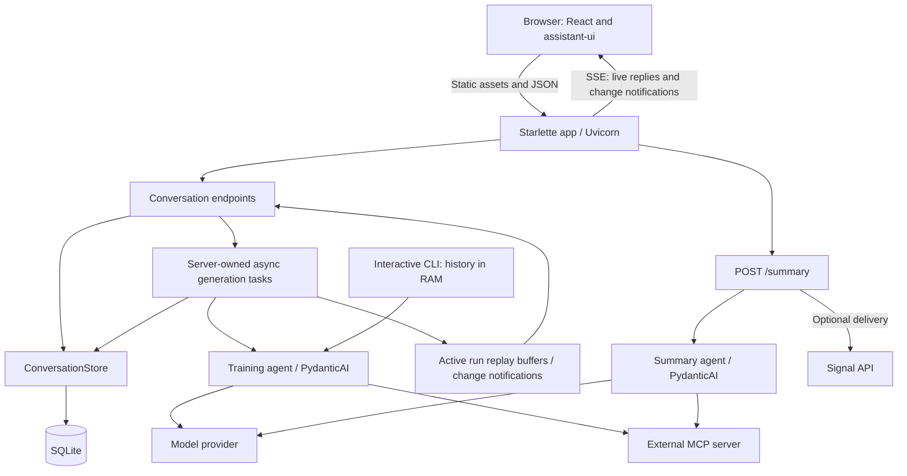
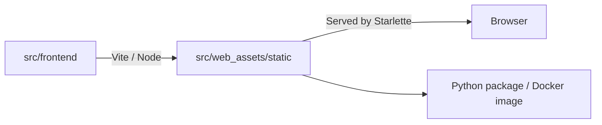

# Application components

## Runtime

| Component | Responsibility | Source |
| --- | --- | --- |
| Web entry point | Load configuration, create agents, register routes, serve built UI | [web.py](../src/web.py) |
| Conversation API | Validate requests, call store commands/queries, own generation tasks and recovery | [conversation_api.py](../src/conversation_api.py) |
| Conversation store | SQLite commands/queries, transactions, ordered history, run state and process lock | [conversation_store.py](../src/conversation_store.py) |
| Database migrations | Shared append-only schema/data migrations, atomic upgrades and version checks | [database_migrations.py](../src/database_migrations.py) |
| Live events | Replay active runs, notify connected browsers, send heartbeat comments | [conversation_events.py](../src/conversation_events.py) |
| Training agent | Model instructions and tools from the external MCP server | [training_agent.py](../src/training_agent.py) |
| Frontend | Thread selection, SSE subscriptions, assistant-ui runtime, Markdown/tool rendering and timestamps | [main.tsx](../src/frontend/main.tsx) |
| Frontend API helper | JSON requests and typed HTTP errors | [api.ts](../src/frontend/api.ts) |
| Stream reader | AI SDK SSE parsing, Vercel protocol assembly and mapping to assistant-ui messages | [stream.ts](../src/frontend/stream.ts) |
| Summary path | Date-window validation, summary generation and optional Signal delivery | [summary_api.py](../src/summary_api.py), [summary_agent.py](../src/summary_agent.py), [signal_sender.py](../src/signal_sender.py) |
| CLI | Interactive agent with temporary conversation history | [cli.py](../src/cli.py) |

## Build and serving

- `make run-web`: build UI, then start Uvicorn with reload on port **7932**.
- `make build-web`: build static UI assets; `make build`: also package Python and assets.
- Node is build tooling. The application server is Python; no Assistant Cloud integration.
- Local access has no application login. Deployment manifests apply Basic Auth at the ingress.
- Optional Logfire instrumentation is configured by the Python entry points.
- On narrow screens, navigation opens in a modal drawer; thread actions use a compact popover.
- Uvicorn allows five seconds for graceful shutdown before cancelling open SSE connections.

See [data model](data-model.md) and [frontend communication](frontend-backend.md).
