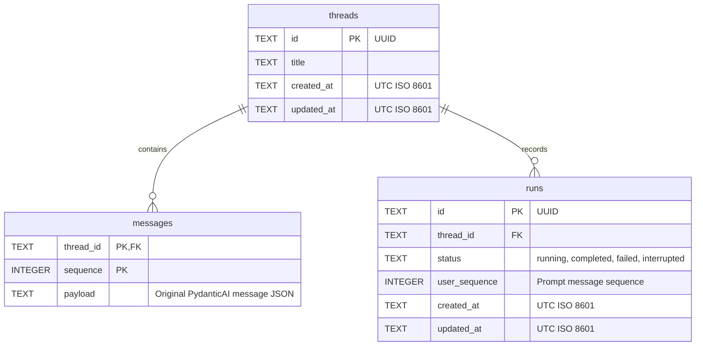
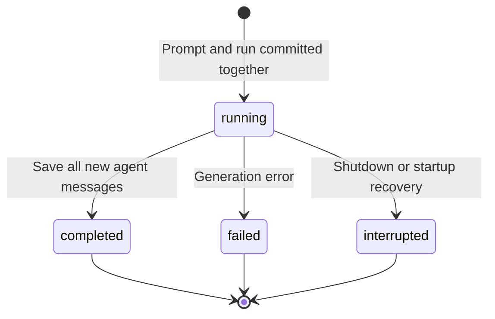

# Data model

Implemented in [conversation_store.py](../src/conversation_store.py).
See also [application components](application-components.md) and
[frontend communication](frontend-backend.md).

## SQLite schema

| Rule | Behavior |
| --- | --- |
| Ownership | One implicit application owner; no user table or owner column. |
| Message key | `(thread_id, sequence)`; sequence starts at 1 within each thread. |
| Message payload | Original requests/responses, including text, tool calls/results and timestamps. |
| Run prompt | `user_sequence` identifies the saved prompt in the same thread; no declared foreign key. |
| Active run | Partial unique index `one_active_run` permits one `running` run per thread. |
| Constraint names | Primary keys, foreign keys, checks and not-null rules use stable `pk_`, `fk_`, `ck_` and `nn_` names. |
| Child FK indexes | The message primary key covers `messages.thread_id`; `runs_by_thread` covers all run states. |
| Deletion | Foreign keys cascade messages and runs; deleting a running thread is rejected. |
| Initial title | `New conversation`, replaced by the first prompt's first 80 normalized characters. |
| Ordering | Threads by latest `updated_at`; messages by `sequence`. |

A stored message is a PydanticAI record, not necessarily one visible chat bubble.
One completed run can append several records through tool calls and responses.

## Run lifecycle

- Retry creates a **new run** for the latest failed/interrupted prompt without duplicating it.
- Failed/interrupted runs retain the saved prompt; partial generated output is not saved.
- Active SSE replay buffers are temporary and separate from SQLite; restarts discard them.
- Generation receives the full saved history. Context summaries are not implemented.

## Storage

| Setting | Current implementation |
| --- | --- |
| File | `DATABASE_PATH`, default `data/conversations.sqlite3` |
| SQLite | WAL mode, foreign keys enabled, schema `user_version = 2` |
| Process ownership | Adjacent `.lock` file; one server process/worker per database |
| Scope | Web conversations only; CLI history and `/summary` output are not stored here |

Local restarts retain data. GKE manifests mount a persistent disk and create checked backups
before schema upgrades. Cluster provisioning and scheduled off-disk backups remain pending;
see [Kubernetes deployment](kubernetes-deployment.md).

All schema changes and persistent data transformations use the shared, versioned migration
runner at startup under the process ownership lock. Migration 2 names existing conversation
constraints while preserving saved values, payload text and row ordering. See [database
migrations](database-migrations.md) for the required workflow, transaction rules, tests, and
deployment recovery.
