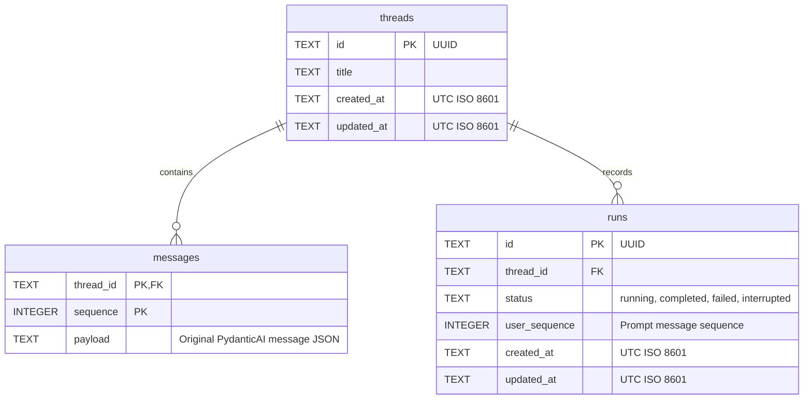
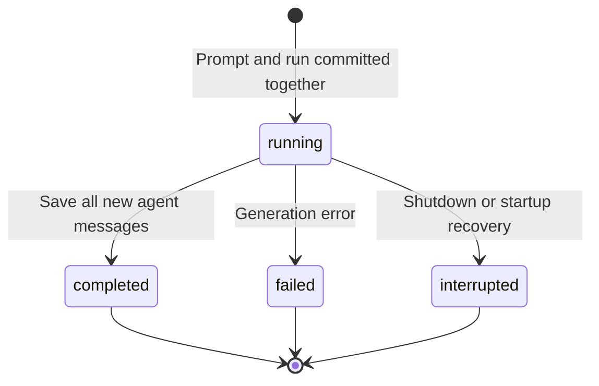
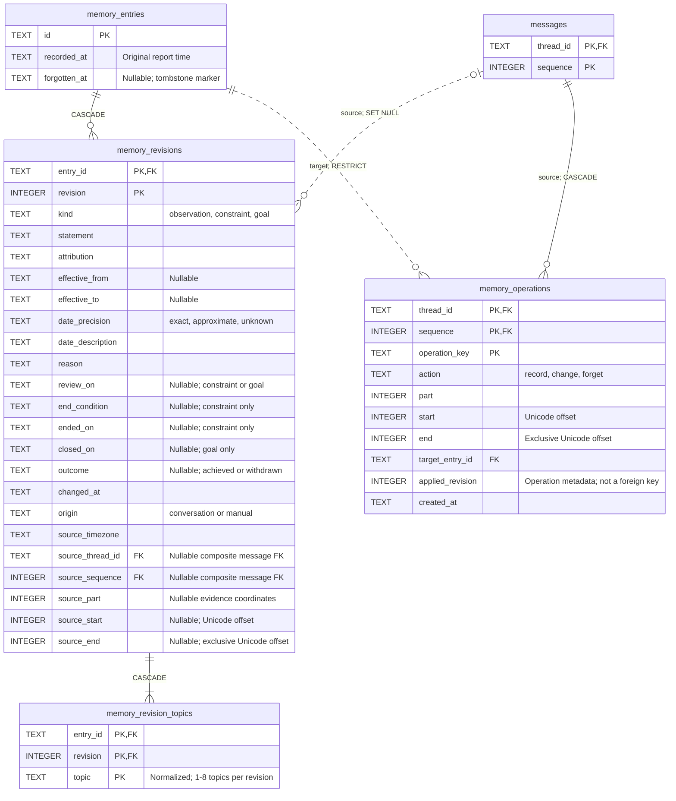

# Data model

Implemented in [conversation_store.py](../src/conversation_store.py).
See also [application components](application-components.md) and
[frontend communication](frontend-backend.md).

## SQLite schema

| Rule | Behavior |
| --- | --- |
| Ownership | One implicit application owner; no user table or owner column. |
| Message key | `(thread_id, sequence)`; sequence starts at 1 within each thread. |
| Message payload | Original requests/responses, including text, tool calls/results and timestamps. |
| Run prompt | `user_sequence` identifies the saved prompt in the same thread; no declared foreign key. |
| Active run | Partial unique index `one_active_run` permits one `running` run per thread. |
| Constraint names | Primary keys, foreign keys, checks and not-null rules use stable `pk_`, `fk_`, `ck_` and `nn_` names. |
| Child FK indexes | The message primary key covers `messages.thread_id`; `runs_by_thread` covers all run states. |
| Deletion | Foreign keys cascade messages and runs; deleting a running thread is rejected. |
| Initial title | `New conversation`, replaced by the first prompt's first 80 normalized characters. |
| Ordering | Threads by latest `updated_at`; messages by `sequence`. |

A stored message is a PydanticAI record, not necessarily one visible chat bubble.
One completed run can append several records through tool calls and responses.

Request-level fields are uneven. The app saves user prompts before their run, so their
`instructions`, `timestamp`, `run_id` and `conversation_id` are `null`; part timestamps remain.
Requests that PydanticAI creates during a run, such as tool results, are saved with all four set.
Their `instructions` are a historical copy of that turn's instructions, including its memory
context, not a per-turn record. Every model request receives freshly generated instructions;
history costing ignores stored copies.

## Run lifecycle

- Retry creates a **new run** for the latest failed/interrupted prompt without duplicating it.
- Failed/interrupted runs retain the saved prompt; partial generated output is not saved.
- Active SSE replay buffers are temporary and separate from SQLite; restarts discard them.
- Generation receives selected complete historical turns with original parts and the full current
  prompt. Current memory and withdrawal notices accompany identifiable references. Memory edits
  do not interrupt runs or remove history. Context summaries are not implemented.

## Storage

| Setting | Current implementation |
| --- | --- |
| File | `DATABASE_PATH`, default `data/conversations.sqlite3` |
| SQLite | WAL mode, foreign keys enabled, schema `user_version = 3` |
| Process ownership | Adjacent `.lock` file; one server process/worker per database |
| Scope | Web conversations and shared memory; CLI history and `/summary` output remain separate |

Local restarts retain data. GKE manifests mount a persistent disk and create checked backups
before schema upgrades. Cluster provisioning and scheduled off-disk backups remain pending;
see [Kubernetes deployment](kubernetes-deployment.md).

All schema changes and persistent data transformations use the shared, versioned migration
runner at startup under the process ownership lock. Migration 2 names existing conversation
constraints while preserving saved values, payload text and row ordering. See [database
migrations](database-migrations.md) for the required workflow, transaction rules, tests, and
deployment recovery.

## Shared training memory

[MemoryStore](../src/memory_store.py) provides concrete transactional queries/commands.
[MemoryData](../src/memory_models.py) validates observations, constraints and goals; API/model
JSON is a projection, not the persistence contract.

| Table | Responsibility |
| --- | --- |
| `memory_entries` | Stable ID, original report timestamp and optional forgetting timestamp |
| `memory_revisions` | One complete relational snapshot per revision, kind, dates, lifecycle, attribution, provenance and nullable message source FK |
| `memory_revision_topics` | Sorted normalized topics owned by `(entry_id, revision)` |
| `memory_operations` | Durable source-message/evidence receipts, retained entry FK and applied revision metadata |

The diagram shows the memory columns and the conversation message key used by source references.
Relationship labels specify the foreign-key deletion rules.

Each live entry has at least one revision; forgotten entries have none. Each revision owns
1–8 topics. These minimum/count rules are enforced by store transactions. The source message
reference on a revision is optional, while every operation receipt requires a source message
and target entry. `applied_revision` retains the committed revision number after forgetting;
it has no foreign key to a revision that forgetting deletes.

`current_memory` selects each live parent's maximum revision before applying filters. Lifecycle
labels derive from dates and closure; no status or memory JSON columns are stored. Goal closure
pairs `closed_on` with `achieved`/`withdrawn`; constraints use `ended_on` independently of expected
effective dates. Full destination validation permits reclassification under the same ID.

Forgetting deletes revisions/topics and retains a content-free tombstone; receipts retain their
original target and applied revision. Live parents have revisions, forgotten parents have none,
and record/change applied revisions exist until forgetting. Store transactions enforce these
cross-row invariants. Receipt outcomes derive from current parent/action/revision relationships.
Every FK has a full child index prefix and compatible parent unique key. Partial unique indexes
also enforce record evidence identity and same-action target operations per source message.

Deleting source messages cascades their receipts and clears revision source FK pairs. Inert
coordinates, origin and timezone survive on retained revisions; shared entries survive. Manual
edits have no invented source. No model call holds a transaction or records exposure writes.

Migration 3 creates this undeployed replacement schema after conversation naming. The shared
runner preserves original messages. Future deployed evolution must preserve every historical
revision/topic/source/receipt through explicit forward migrations; there is no memory format tag.

[Context preparation](../src/memory_context.py) reads one consistent snapshot per turn: required
constraints/open goals/retry context, separately bounded recent observations, then newest complete
history with reference additions. Historical memory results are never rewritten. Unknown IDs do
not prove withdrawal. See [shared training memory](shared-training-memory.md) for budgets,
precedence, lifecycle and the preserved-history forgetting scope.
