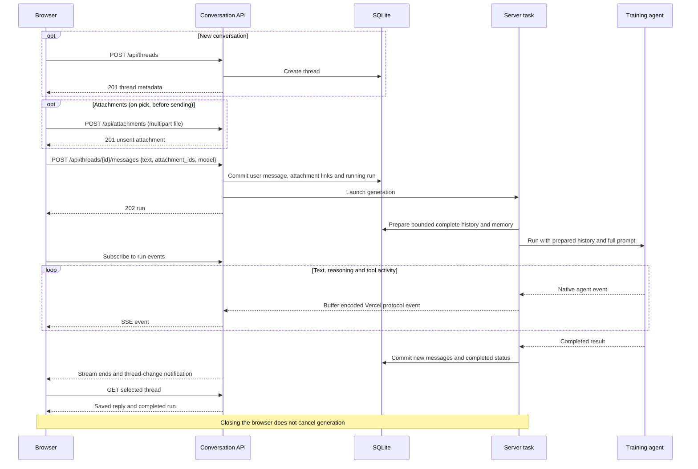

# Frontend–backend communication

The browser calls same-origin JSON endpoints using [api.ts](../src/frontend/api.ts).
[main.tsx](../src/frontend/main.tsx) maps saved PydanticAI records into assistant-ui messages.
[stream.ts](../src/frontend/stream.ts) uses the AI SDK to read live Vercel protocol events.

## Sending a message

Generation runs independently of both SSE subscriptions. No WebSocket connection is needed.

## Endpoints

Implemented in [conversation_api.py](../src/training_ai/conversation_api.py).
`{id}` below is the thread UUID.

| Method | Path | Request JSON | Success response |
| --- | --- | --- | --- |
| GET | `/api/threads` | — | `200`: thread metadata array, newest activity first |
| POST | `/api/threads` | — | `201`: new thread metadata |
| GET | `/api/threads/{id}` | — | `200`: thread detail |
| PATCH | `/api/threads/{id}` | `{"title":"..."}` | `200`: updated thread detail |
| DELETE | `/api/threads/{id}` | — | `200`: `{"deleted":true}` |
| POST | `/api/threads/{id}/messages` | `{"text":"...","attachment_ids":[...],"model":"..."}` | `202`: new running run |
| POST | `/api/threads/{id}/retry` | Optional `{"model":"..."}` | `202`: new run reusing the saved prompt |
| GET | `/api/models` | — | `200`: `{"default": id, "models": [{"id", "label"}]}` in configured order |
| GET | `/api/health` | — | `200`: `{"status":"ok"}` |
| GET | `/api/events` | — | `200`: SSE `ready` / `changed` notifications |
| GET | `/api/threads/{id}/runs/{run_id}/events` | — | `200`: Vercel AI SDK v7 SSE stream |
| GET | `/api/memory` | — | `200`: paginated entries and `next_offset` |
| GET | `/api/memory/{id}` | — | `200`: entry, source links and revision history, or content-free forgotten status |
| PATCH | `/api/memory/{id}` | `expected_revision`, full `data` | `200`: current updated entry |
| DELETE | `/api/memory/{id}` | `expected_revision` | `200`: forgetting receipt |
| POST | `/api/attachments` | Multipart `file` | `201`: unsent attachment |
| GET | `/api/attachments/{id}/content` | — | `200`: original bytes, name and media type |
| DELETE | `/api/attachments/{id}` | — | `204`: unsent upload deleted |
| GET | `/api/plans` | — | `200`: `{"plans": [...]}`, newest start date first |
| GET | `/api/plans/{id}` | — | `200`: a plan's full content and version |
| DELETE | `/api/plans/{id}` | — | `200`: `{"deleted":true}` |
| GET | `/api/plans/{id}/sources/{source_id}/content` | — | `200`: the source document's bytes, name and media type |

| Response shape | Fields |
| --- | --- |
| Thread metadata | `id`, `title`, `created_at`, `updated_at` |
| Thread detail | Metadata + `messages: [{sequence, payload, attachments?}]` + latest `run` or `null` + current `model`; optional `memory_receipts` and `plan_receipts` |
| Attachment | `id`, `file_name`, `media_type`, `size_bytes`, `content_sha256` |
| Plan summary | `id`, `kind` (`block` or `programme`), `title`, `phase`, `focus`, `start_date`, `end_date`, `version` |
| Plan | Summary + `weeks`, `sessions` (each with `options` and their `parts`, which name the linked workout), `workouts`, `recurring`, `guidance`, `open_questions`, `sources` |
| Run | `id`, `thread_id`, `status`, `user_sequence`, `created_at`, `updated_at`, `model` |
| Error | `{"error":"..."}` |

Send and retry take an optional `model`: a selectable model id from `/api/models`. Without it
the run uses the thread's current `model`: its latest run's model while that model is still
selectable, else the default. A model `label` is the id without its provider prefix.

## Synchronization and errors

- Initial load, selection, mutations and SSE notifications trigger snapshot fetches.
- Refreshes fetch the list and selected detail in parallel with `cache: "no-store"`; no polling.
- The change channel reconnects automatically and sends `ready` before fetching fresh snapshots.
- Active run subscriptions replay from the beginning into a fresh reader, then follow live events.
- Live content replaces the previous live snapshot; completion replaces it with saved messages.
- Transport/refresh failures retry with backoff; reconnects never resubmit the user prompt.
- Heartbeat comments every 15 seconds keep idle connections open; SSE responses disable buffering.
- Replay uses a temporary buffer per active run, spilling to a temporary file above 256 KiB.
- Completed streams leave the active registry; reopening retrieves saved history from SQLite.
- Detail includes the full saved history; there is no pagination.
- `?thread=<id>` records the selected conversation for reopening or sharing across browsers.
- Selection/version checks discard stale detail responses after switching threads.
- Saved timestamps display in the browser's locale and time zone.
- `400`: malformed/empty input, message over 1,000,000 characters, title over 200 characters, or
  a send/retry `model` that is not selectable (nothing is saved).
- `404`: missing thread; the UI clears a deleted selection.
- `409`: active run blocks another send/retry/delete, or the latest run cannot be retried.
- Run subscriptions also return `409` after completion; the browser reloads saved thread detail.
- Rejected sends restore the composer draft. A refresh failure after acceptance does not resend it.
- On restart, unfinished runs become `interrupted`; retry is manual and creates a new run.

The Memory dialog in [memory.tsx](../src/frontend/memory.tsx) uses the same change channel
to refresh lists and clean editors across devices. Dirty edits stay local; a save with an
outdated revision returns `409` and offers reload. Opening memory retains the composer;
opening a source selects its conversation. Memory writes notify browsers immediately,
independently of model-response completion. Thread receipts resolve current entry text;
forgotten entries show no retained statement. Superseded receipts show the current revision.
Receipts appear as floating notices that disappear after five seconds without resizing the
transcript. Only responses this browser started (send or retry) notify; opening, reloading or
resuming a thread, and other devices' activity, never do. Expired notices are dropped when a
paused background tab becomes visible again.
Goal closure/resumption and kind correction use the same revision-checked PATCH contract.
Required-memory overflow fails before provider use; thread detail includes `context_error` while
the current server retains that diagnostic. It survives snapshot refreshes but not server restart.

Memory listing accepts `topic`, `kind`, `status`, `start`, `end`, `offset` and `limit` (1–100).
Date ranges overlap effective dates; unknown bounds are retained as uncertain matches.
Malformed data/filters return `400`; missing entries return `404`. These endpoints share the
existing ingress authentication boundary. See [shared training memory](shared-training-memory.md).

## Attachments

Implemented in [attachment_api.py](../src/training_ai/attachment_api.py). The composer uploads
each file when it is picked or dropped, and the send request refers to the returned ids, so the
send stays a small atomic JSON request. Removing a chip before sending deletes that upload.

| Rule | Behavior |
| --- | --- |
| Accepted files | PDF, PNG, JPEG and WebP, detected from the leading bytes; the declared type must match. |
| Size | At most 20 MB, enforced while the upload is read (`413`). |
| Per message | Up to 5 unsent uploads; text may be empty when at least one is attached. |
| Duplicates | Identical bytes share stored content; every upload still gets its own id. |
| Upload errors | `400` for other or mismatched types, an empty file or a missing `file` field. |
| Send errors | `400` for unknown, removed, already sent or duplicate ids, or more than 5; nothing is saved. |
| Removal | `DELETE` returns `204` for an unsent upload, `409` once sent, `404` when unknown. |
| Download | `Content-Disposition: attachment` with the original name; `404` when unknown. |
| Storage errors | `503` when the byte store cannot be reached; text-only chat keeps working. |
| Deleted threads | Their attachments return `404`; the same file attached elsewhere still downloads. |

The composer shows each upload as a tile with its progress and a remove button. Sent attachments
appear above their message as rows with the file name, size and a type icon or image thumbnail;
opening one downloads the original file.

## Plans

Implemented in [plan_api.py](../src/training_ai/plan_api.py). Plans are written only by the
chat assistant's tools; the API reads, deletes and serves source documents.

| Rule | Behavior |
| --- | --- |
| Unknown plan or source | `404`. |
| Deletion | Removes the plan and all its content; programmes, other blocks and shared memory are untouched. |
| Sources | Downloadable by plan and source id even after the chat thread that carried the file is deleted; the attachment endpoint returns `404` then. |
| Live updates | Every committed plan write (extraction, re-extraction, edit, deletion) sends the generic `changed` event on `/api/events`. The plan list and plan page refetch on `ready` and `changed`, keep the current content while refetching, and treat a `404` as "deleted". |

`POST /summary` is a separate integration endpoint, unused by the chat UI.
See [application components](application-components.md) and [data model](data-model.md).
