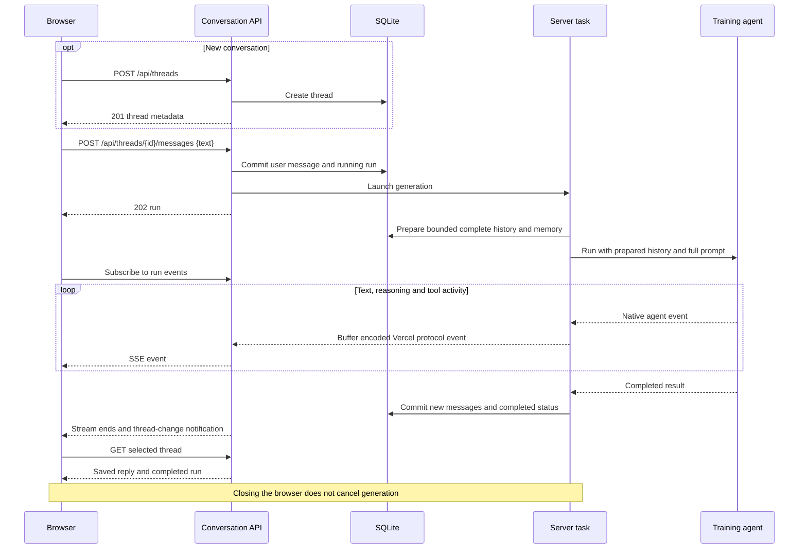

# Frontend–backend communication

The browser calls same-origin JSON endpoints using [api.ts](../src/frontend/api.ts).
[main.tsx](../src/frontend/main.tsx) maps saved PydanticAI records into assistant-ui messages.
[stream.ts](../src/frontend/stream.ts) uses the AI SDK to read live Vercel protocol events.

## Sending a message

Generation runs independently of both SSE subscriptions. No WebSocket connection is needed.

## Endpoints

Implemented in [conversation_api.py](../src/conversation_api.py).
`{id}` below is the thread UUID.

| Method | Path | Request JSON | Success response |
| --- | --- | --- | --- |
| GET | `/api/threads` | — | `200`: thread metadata array, newest activity first |
| POST | `/api/threads` | — | `201`: new thread metadata |
| GET | `/api/threads/{id}` | — | `200`: thread detail |
| PATCH | `/api/threads/{id}` | `{"title":"..."}` | `200`: updated thread detail |
| DELETE | `/api/threads/{id}` | — | `200`: `{"deleted":true}` |
| POST | `/api/threads/{id}/messages` | `{"text":"..."}` | `202`: new running run |
| POST | `/api/threads/{id}/retry` | — | `202`: new run reusing the saved prompt |
| GET | `/api/health` | — | `200`: `{"status":"ok"}` |
| GET | `/api/events` | — | `200`: SSE `ready` / `changed` notifications |
| GET | `/api/threads/{id}/runs/{run_id}/events` | — | `200`: Vercel AI SDK v7 SSE stream |
| GET | `/api/memory` | — | `200`: paginated entries and `next_offset` |
| GET | `/api/memory/{id}` | — | `200`: entry, source links and revision history, or content-free forgotten status |
| PATCH | `/api/memory/{id}` | `expected_revision`, full `data` | `200`: current updated entry |
| DELETE | `/api/memory/{id}` | `expected_revision` | `200`: forgetting receipt |

| Response shape | Fields |
| --- | --- |
| Thread metadata | `id`, `title`, `created_at`, `updated_at` |
| Thread detail | Metadata + `messages: [{sequence, payload}]` + latest `run` or `null`; optional `memory_receipts` |
| Run | `id`, `thread_id`, `status`, `user_sequence`, `created_at`, `updated_at` |
| Error | `{"error":"..."}` |

## Synchronization and errors

- Initial load, selection, mutations and SSE notifications trigger snapshot fetches.
- Refreshes fetch the list and selected detail in parallel with `cache: "no-store"`; no polling.
- The change channel reconnects automatically and sends `ready` before fetching fresh snapshots.
- Active run subscriptions replay from the beginning into a fresh reader, then follow live events.
- Live content replaces the previous live snapshot; completion replaces it with saved messages.
- Transport/refresh failures retry with backoff; reconnects never resubmit the user prompt.
- Heartbeat comments every 15 seconds keep idle connections open; SSE responses disable buffering.
- Replay uses a temporary buffer per active run, spilling to a temporary file above 256 KiB.
- Completed streams leave the active registry; reopening retrieves saved history from SQLite.
- Detail includes the full saved history; there is no pagination.
- `?thread=<id>` records the selected conversation for reopening or sharing across browsers.
- Selection/version checks discard stale detail responses after switching threads.
- Saved timestamps display in the browser's locale and time zone.
- `400`: malformed/empty input, message over 1,000,000 characters, or title over 200 characters.
- `404`: missing thread; the UI clears a deleted selection.
- `409`: active run blocks another send/retry/delete, or the latest run cannot be retried.
- Run subscriptions also return `409` after completion; the browser reloads saved thread detail.
- Rejected sends restore the composer draft. A refresh failure after acceptance does not resend it.
- On restart, unfinished runs become `interrupted`; retry is manual and creates a new run.

The Memory dialog in [memory.tsx](../src/frontend/memory.tsx) uses the same change channel
to refresh lists and clean editors across devices. Dirty edits stay local; a save with an
outdated revision returns `409` and offers reload. Opening memory retains the composer;
opening a source selects its conversation. Memory writes notify browsers immediately,
independently of model-response completion. Thread receipts resolve current entry text;
forgotten entries show no retained statement. Superseded receipts show the current revision.
Receipts appear as floating notices that disappear after five seconds without resizing the
transcript. Opening a thread notifies only about its latest turn; a later status change, such as
forgetting, notifies again.
Goal closure/resumption and kind correction use the same revision-checked PATCH contract.
Required-memory overflow fails before provider use; thread detail includes `context_error` while
the current server retains that diagnostic. It survives snapshot refreshes but not server restart.

Memory listing accepts `topic`, `kind`, `status`, `start`, `end`, `offset` and `limit` (1–100).
Date ranges overlap effective dates; unknown bounds are retained as uncertain matches.
Malformed data/filters return `400`; missing entries return `404`. These endpoints share the
existing ingress authentication boundary. See [shared training memory](shared-training-memory.md).

`POST /summary` is a separate integration endpoint, unused by the chat UI.
See [application components](application-components.md) and [data model](data-model.md).
