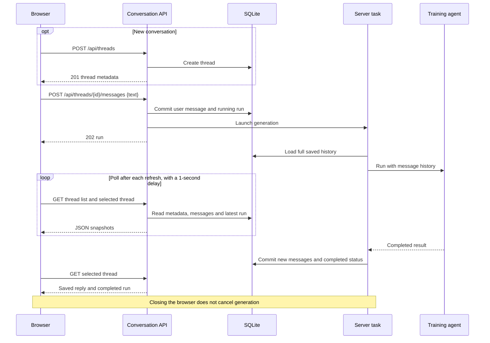

# Frontend–backend communication

The browser calls same-origin JSON endpoints using [api.ts](../src/frontend/api.ts).
[main.tsx](../src/frontend/main.tsx) maps saved PydanticAI records into assistant-ui messages.

## Sending a message

Replies appear after completion. There is no token streaming, SSE or WebSocket connection.

## Endpoints

Implemented in [conversation_api.py](../src/conversation_api.py).
`{id}` below is the thread UUID.

| Method | Path | Request JSON | Success response |
| --- | --- | --- | --- |
| GET | `/api/threads` | — | `200`: thread metadata array, newest activity first |
| POST | `/api/threads` | — | `201`: new thread metadata |
| GET | `/api/threads/{id}` | — | `200`: thread detail |
| PATCH | `/api/threads/{id}` | `{"title":"..."}` | `200`: updated thread detail |
| DELETE | `/api/threads/{id}` | — | `200`: `{"deleted":true}` |
| POST | `/api/threads/{id}/messages` | `{"text":"..."}` | `202`: new running run |
| POST | `/api/threads/{id}/retry` | — | `202`: new run reusing the saved prompt |
| GET | `/api/health` | — | `200`: `{"status":"ok"}` |

| Response shape | Fields |
| --- | --- |
| Thread metadata | `id`, `title`, `created_at`, `updated_at` |
| Thread detail | Metadata + `messages: [{sequence, payload}]` + latest `run` or `null` |
| Run | `id`, `thread_id`, `status`, `user_sequence`, `created_at`, `updated_at` |
| Error | `{"error":"..."}` |

## Synchronization and errors

- Refreshes fetch the list and selected detail in parallel with `cache: "no-store"`.
- Detail includes the full saved history; there is no pagination.
- `?thread=<id>` records the selected conversation for reopening or sharing across browsers.
- Selection/version checks discard stale detail responses after switching threads.
- Saved timestamps display in the browser's locale and time zone.
- `400`: malformed/empty input, message over 32,000 characters, or title over 200 characters.
- `404`: missing thread; the UI clears a deleted selection.
- `409`: active run blocks another send/retry/delete, or the latest run cannot be retried.
- Rejected sends restore the composer draft. A refresh failure after acceptance does not resend it.
- On restart, unfinished runs become `interrupted`; retry is manual and creates a new run.

`POST /summary` is a separate integration endpoint, unused by the chat UI.
See [application components](application-components.md) and [data model](data-model.md).
