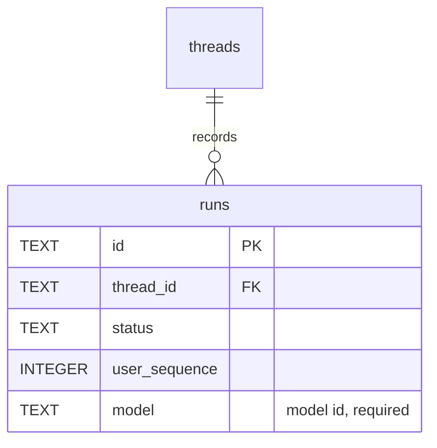

# Design

## Context

- `load_config` reads one `MODEL` string. `create_app` builds the chat agent, summary agent and
  plan-extraction sub-agent from it, and passes the same string to plans as the recorded
  `extraction_model`.
- `create_conversation_app(agent, ...)` runs each chat turn with
  `agent.run_stream_events(message_history=..., deps=...)`. In pydantic-ai 2.55 that call (like
  `Agent.run`) also accepts `model=`, which overrides the agent's model for one run.
- `pydantic_ai.models.infer_model("<provider>:<name>")` raises `UserError` straight away for an
  unknown provider or model and for a missing provider API key. So every configured model can be
  checked at startup.
- Saved `ModelResponse` payloads already carry `model_name` and `provider_name`. When a provider
  builds a request, it skips `ThinkingPart`s and provider-specific details that came from
  another provider (`provider_name == self.system` checks in `models/openai.py` and
  `models/anthropic.py`).
- `runs` (migration 2) has named constraints and the `runs_by_thread` index. Migrations 1–5 are
  applied in production.
- The composer has an unused `ComposerExtra` slot in its action row (`thread.aui.tsx`), and
  `components/ui/native-select.tsx` exists.

## Goals / Non-Goals

**Goals:**

- One chat agent serves every model; the model is chosen per run.
- A misconfigured model list fails at startup, never mid-conversation.
- The recorded model is part of the relational data model; the current model is derived, not
  duplicated.
- Tests can inject several fake models without network or API keys.

**Non-Goals:**

- Per-model agents, instructions or tool sets.
- Detecting which models support PDFs, images or tools. Only models that support these features
  should be listed.

## Decisions

### Model catalog resolved once at startup

`Config` gains `chat_models: tuple[str, ...]` (model ids) parsed from `CHAT_MODELS`. Parsing
rules:

- Split on commas and trim each entry.
- The label is the id without its provider prefix: the text after the first `:`
  (`anthropic:claude-opus-5-5` → `claude-opus-5-5`). pydantic-ai still gets the full id, since
  `infer_model("claude-opus-5-5")` fails with "Unknown model".
- Empty entries, ids without a `:` prefix or with an empty name are errors. So are duplicate ids
  and duplicate labels (`openai:gpt-6.1-sol` and `openai-chat:gpt-6.1-sol`).
- When `MODEL` isn't in the list, prepend it.

Labels aren't configurable. The picker shows the real model name, so there is no display text
that could fall out of date.

`create_app` turns this into a `ModelCatalog`: a small frozen value holding the default id, the
ordered `(id, label)` entries and a `Model` for each id, made with `infer_model`. A failure there
is re-raised as a `RuntimeError` naming the entry. The provider's message is not included,
because it describes credential setup.

`create_conversation_app` takes an optional `models: ModelCatalog`. When it is omitted, a
one-entry catalog wraps the agent's own model under `model_name`, or `"default"` if that is
empty. Existing tests and the browser server keep working unchanged, and new tests pass
`FunctionModel`s under ids such as `test:gpt` and `test:claude`.

Alternatives considered:

- Resolving model strings lazily at run time. Rejected: a missing key would only show up as a
  failed chat run.
- One agent per model. Rejected: tools, instructions and memory would be registered several
  times for no gain, since `model=` already overrides per run.

### Runs record the model id; the thread's model is derived

Migration 6 rebuilds `runs` with a required model and fills existing rows in. It follows the
migration 2 pattern: `suspend_foreign_keys`, create `runs_with_model`, copy rows keeping their
`rowid`, validate the copy with `EXCEPT` both ways, drop and rename, then recreate
`one_active_run` and `runs_by_thread`. The new column is:

```sql
model TEXT CONSTRAINT nn_runs_model NOT NULL
    CONSTRAINT ck_runs_model CHECK (length(model) > 0)
```

Existing rows get `'openai:gpt-6.1-sol'`. That was the only model used before this change, and
it is the deployment's `MODEL` id. `openai:` and `openai-responses:` resolve to the same
Responses model in pydantic-ai, but they are different ids, so the deployment keeps the
`openai:` spelling and existing threads match its catalog entry. On a fresh database there is
nothing to fill.



| Rule | Behavior |
| --- | --- |
| Stored value | The full model id (`anthropic:claude-opus-5-5`), which tells providers apart. |
| Earlier runs | Filled with `openai:gpt-6.1-sol`, the only model used before this change. |
| Current model | Latest run's `model` if it is in the catalog, else the catalog default. Computed by the existing latest-run query, no new index. |
| New runs | `start_run` writes the resolved id in the same transaction as the prompt and run. |

There is no foreign key and no `models` table. The model list is configuration, and a run must
keep its record after a model is removed from `CHAT_MODELS`.

Alternative considered: a `threads.model` column. Rejected: it would duplicate the latest run's
model and need updating in the same transaction. Saving an unsent picker change is explicitly
not wanted.

### API contract

- `GET /api/models` returns `{"default": id, "models": [{"id", "label"}]}`.
- `POST /messages` and `POST /retry` accept optional `"model": id`. The handler validates it
  against the catalog (400 `{"error": "Unknown model."}` before anything is saved). When it is
  omitted, the thread's current model is used. The retry body is optional, as today.
- Run objects gain `model`, and thread detail gains `model` (the current model id).
- `native_events` looks up `catalog.model(run["model"])` and passes it as `model=` to
  `run_stream_events`. A run whose recorded model was removed by a restart in the meantime can't
  be running, because startup interrupts all runs. A retry then resolves a new model.

### Extraction uses the run's model

`PlanAccess` gets `model` (the `Model` object) beside the existing `model_name`, both set from
the run. `extract(agent, inputs, model)` calls `agent.run(prompt, model=model)`. `save_extraction`
and re-extraction already store `access.model_name` as `extraction_model`, so they now record the
run's id without any other change. The sub-agent itself is built once, with the default model.

### Frontend picker

- `main.tsx` loads `/api/models` once.
- Picker state is a per-session override for the selected thread. It resets on thread switch and
  after a send or retry is accepted.
- The shown value is `override ?? detail.model ?? catalog.default`.
- The picker renders in `ComposerExtra` as a `NativeSelect` labelled "Model". It is disabled
  while a response is running or busy, and hidden when the catalog has one entry.
- Send and retry include `model: shown`.
- Live updates refetch detail, so another device's switch shows up after its run starts.

## Risks / Trade-offs

- [Cross-provider replay fails in a way the fake models can't show, for example tool-call id
  formats, an OpenAI Responses item that Anthropic rejects, or a PDF in history] → The run fails
  visibly and the prompt stays saved, so the user can retry on the previous model. A paid manual
  check needs the user's approval (tasks).
- [One bad `CHAT_MODELS` entry or a removed API key stops the whole server] → This is
  intentional and consistent with `MODEL`. The error names the entry, and the fix is a config
  change and restart.
- [A listed model lacks PDF or image input] → It is not detected. The attachment run fails with
  the provider error masked as "Response failed". The README says to list only multimodal,
  tool-calling models.
- [Different providers count context differently] → The history budget is in characters and
  independent of the model, so it is unchanged.

## Migration Plan

1. Migration 6 rebuilds `runs` with a required `model` and fills existing rows with
   `openai:gpt-6.1-sol`. The migration validates its own copy before dropping the old table.
   It gets no new automated test: a row copy plus one constant is verified by reading the
   migration, and by upgrading a copy of a local database.
2. Deployment (needs approval): add `CHAT_MODELS` to `deployment/k8s/app/deployment.yaml`. The
   manifest already references `ANTHROPIC_API_KEY` from `training-ai-secrets`. The pre-upgrade
   SQLite backup runs as usual.
3. Rollback: an older image refuses schema version 6. Restore the pre-upgrade backup, or roll
   forward with `CHAT_MODELS` removed, which restores today's single-model behavior.
