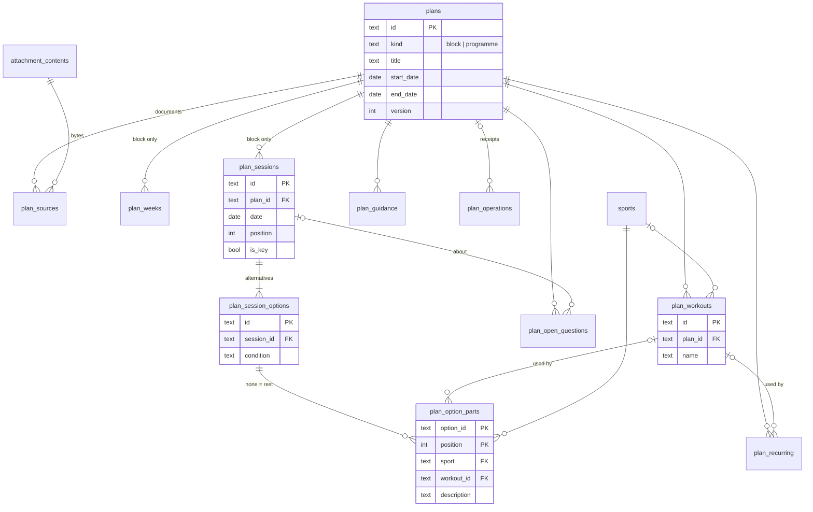

# Design

## Context

See proposal.md for motivation; requirements are in this change's specs.

- `add-chat-attachments` provides stored, content-addressed attachments and the rule that model
  requests receive attachment content only in their own turn.
- Chat turns and summaries share a memory context builder and read-only memory tools; chat adds
  memory write tools. This change leaves memory untouched.
- The summary agent's base instructions come from `BASE_INSTRUCTIONS`, so each deployment
  decides what a summary contains, including whether it suggests sessions.
- The MCP server is external and provider-specific. The app may rely only on what its tools
  expose at runtime; the chat agent can already read the user's calendar events through it.
- Application-owned data is stored relationally, never as JSON in columns.

What coach documents look like, from a review of two seasons of real plans (kept private; only
structural conclusions are recorded here):

- Main plans cover 3–5 weeks and follow a recurring template, adapted each time. They open with
  a phase name, a review of the last period, the focus of this one, key dates and a preview of
  the next period and the season.
- A weekly calendar table gives each day's sports in abbreviations, a week type (recovery, base,
  volume) and marks key sessions in red. Red is also used elsewhere for plain emphasis, in
  several shades, and documents may contain tracked-change text where old and new values run
  together.
- Daily entries follow, with morning and evening sessions, bricks, many alternatives (equal
  choices, optional rest, variants by target race, "race or equivalent session"), group sessions
  with time and place, tests and races, and a weekly hours range.
- Numbered workout libraries (swim, bike, run drills) are redefined in every plan, so the same
  number means different workouts in different plans. Workouts can contain week-specific
  variants.
- Supplementary documents are strength and mobility instructions, gym programmes spanning
  several plans, focus programmes made of ordered workouts with weekly frequency guidance, and
  off-season guidance with weekly targets. They have no day-by-day schedule.
- Habits come with frequencies (daily, twice a week, before runs). Much detail is only behind
  links (videos, test protocols). Some documents are image-only.

## Goals / Non-Goals

**Goals:**

- A distilled, relational representation of the user's current training that serves chat, the
  summary and the plan page, with no merging at read time.
- Keep the coach's workouts, habits and guidance reachable from every session and date.
- Keep context cost bounded: a small pointer every turn, details on demand.

**Non-Goals:**

- Mirroring the document's layout (sections, pages, excerpts). The source PDF is the reference
  for the original.
- Change history of plan content, or showing what was edited.
- Interval-level workout structure or export to structured workout formats.
- Races, camps and other individual participation in the plan.
- A general document-understanding pipeline for non-plan attachments.
- Writing sessions to the external calendar; that is `add-plan-calendar-export`.
- Trimming or replacing overlapping blocks.

## Decisions

### Blocks and programmes share one parent table

Both kinds of plan have a title, a date range, sources, a version and the same kinds of content
(workouts, recurring items, guidance, open questions). One parent table `plans` with a `kind`
column lets every content table reference a single parent. Block-only content (weeks, sessions)
is restricted to blocks by the command layer, which is the only writer. Overlap between blocks
is also checked there, inside the writing transaction (`BEGIN IMMEDIATE`); it cannot be
expressed as a SQLite constraint.

Alternatives considered:

- Separate `plan_blocks` and `plan_programmes` tables, with each content table holding two
  nullable foreign keys and a check that exactly one is set. Rejected: every query and index
  doubles for no behavioral difference.
- Supplementary documents merged into a block. Rejected: a gym programme spanning several blocks
  would be copied into each, and off-season guidance has no block at all.

### Relational schema

One migration through the shared runner. All child tables cascade from their parent on delete
unless stated otherwise. All required columns carry named `nn_` constraints. Ids are TEXT
UUIDs, like the existing tables, so they stay stable and unambiguous in tool calls.



`attachment_contents` comes from `add-chat-attachments`.

#### `plans`

| Column | Type | Null | Notes |
| --- | --- | --- | --- |
| `id` | text | no | `pk_plans` |
| `kind` | text | no | `ck_plans_kind`: `block`, `programme` |
| `title` | text | no | |
| `phase` | text | yes | e.g. "base period 3" |
| `focus` | text | yes | distilled focus of the period |
| `start_date`, `end_date` | date | no | `ck_plans_range`: start ≤ end |
| `version` | integer | no | `ck_plans_version` positive; incremented on every write |
| `extraction_model`, `extraction_prompt_version` | text | no | |
| `created_at`, `updated_at` | timestamp | no | |

Index `plans_by_kind_dates` `(kind, start_date, end_date)` serves date lookups.

#### `plan_sources`

| Column | Type | Null | Notes |
| --- | --- | --- | --- |
| `id` | text | no | `pk_plan_sources` |
| `plan_id` | text | no | `fk_plan_sources_plan` |
| `attachment_content_sha256` | text | no | `fk_plan_sources_content` → `attachment_contents`, no cascade; index `plan_sources_by_content` |
| `file_name`, `media_type` | text | no | copied from the upload |
| `added_at` | timestamp | no | |

`uq_plan_sources_content` `(plan_id, attachment_content_sha256)` is also the child index.

The source points at the stored bytes (`attachment_contents`), not at an `attachments` row:
attachment rows belong to a chat message and are deleted with their thread, while a plan's
documents stay downloadable. The later attachment cleanup change must count these rows as
references.

#### `plan_weeks` (blocks only)

| Column | Type | Null | Notes |
| --- | --- | --- | --- |
| `plan_id` | text | no | `fk_plan_weeks_plan` |
| `week_start` | date | no | `pk_plan_weeks` `(plan_id, week_start)`, also the child index; `ck_plan_weeks_monday` |
| `label` | text | yes | e.g. recovery, base, volume |
| `hours_min`, `hours_max` | real | yes | `ck_plan_weeks_hours`: non-negative, min ≤ max |

A week's Monday may precede the block's start by up to six days, since plans can start on a
Sunday.

#### `plan_sessions` (blocks only)

| Column | Type | Null | Notes |
| --- | --- | --- | --- |
| `id` | text | no | `pk_plan_sessions` |
| `plan_id` | text | no | `fk_plan_sessions_plan` |
| `date` | date | no | |
| `position` | integer | no | order within the day; `uq_plan_sessions_position` `(plan_id, date, position)` is also the child and range index |
| `title` | text | no | |
| `description` | text | yes | what applies to the whole session |
| `is_key` | boolean | no | |
| `start_time`, `location` | text | yes | group sessions |

#### `plan_session_options`

| Column | Type | Null | Notes |
| --- | --- | --- | --- |
| `id` | text | no | `pk_plan_session_options` |
| `session_id` | text | no | `fk_plan_session_options_session` |
| `position` | integer | no | `uq_plan_session_options_position` `(session_id, position)`, also the child index |
| `condition` | text | yes | e.g. "if tired" |
| `description` | text | yes | note shared by the option's parts |

#### `plan_option_parts`

An option without parts means rest.

| Column | Type | Null | Notes |
| --- | --- | --- | --- |
| `option_id` | text | no | `fk_plan_option_parts_option` |
| `position` | integer | no | `pk_plan_option_parts` `(option_id, position)`, also the child index |
| `sport` | text | no | `fk_plan_option_parts_sport` → `sports`; index `plan_option_parts_by_sport` |
| `workout_id` | text | yes | `fk_plan_option_parts_workout`, `ON DELETE SET NULL`; index `plan_option_parts_by_workout`; may point to an active programme's workout |
| `duration_min_minutes`, `duration_max_minutes` | integer | yes | `ck_plan_option_parts_duration`: positive, min ≤ max |
| `description` | text | yes | the part's instructions, e.g. intensity and drills |

#### `plan_workouts`

| Column | Type | Null | Notes |
| --- | --- | --- | --- |
| `id` | text | no | `pk_plan_workouts` |
| `plan_id` | text | no | `fk_plan_workouts_plan` |
| `name` | text | no | `uq_plan_workouts_name` `(plan_id, name)`, also the child index |
| `sport` | text | yes | `fk_plan_workouts_sport`; null for mixed routines; index `plan_workouts_by_sport` |
| `description` | text | no | |
| `url` | text | yes | |

#### `plan_recurring`

| Column | Type | Null | Notes |
| --- | --- | --- | --- |
| `id` | text | no | `pk_plan_recurring` |
| `plan_id` | text | no | `fk_plan_recurring_plan` |
| `position` | integer | no | `uq_plan_recurring_position` `(plan_id, position)`, also the child index |
| `text` | text | no | the habit and how often, in the coach's words, e.g. "foot strengthening 2–3 times a week" |
| `workout_id` | text | yes | `fk_plan_recurring_workout`, `ON DELETE SET NULL`; index `plan_recurring_by_workout`; may point to an overlapping programme's workout |

#### `plan_guidance`

| Column | Type | Null | Notes |
| --- | --- | --- | --- |
| `id` | text | no | `pk_plan_guidance` |
| `plan_id` | text | no | `fk_plan_guidance_plan` |
| `position` | integer | no | `uq_plan_guidance_position` `(plan_id, position)`, also the child index |
| `kind` | text | no | `ck_plan_guidance_kind`: `rule`, `advice`, `upcoming` |
| `topic`, `text` | text | no | |
| `event_date` | date | yes | only for `upcoming` (`ck_plan_guidance_event_date`) |
| `url` | text | yes | |

#### `plan_open_questions`

| Column | Type | Null | Notes |
| --- | --- | --- | --- |
| `id` | text | no | `pk_plan_open_questions` |
| `plan_id` | text | no | `fk_plan_open_questions_plan`; index `plan_open_questions_by_plan` |
| `session_id` | text | yes | `fk_plan_open_questions_session`; index `plan_open_questions_by_session` |
| `question` | text | no | |

#### `sports`

| Column | Type | Null | Notes |
| --- | --- | --- | --- |
| `code` | text | no | `pk_sports`; seeded with `swim`, `bike`, `run`, `strength`, `mobility`, `ski`, `walk`, `other` |

A lookup table, so a new sport is an inserted row rather than a table rebuild.

#### `plan_operations`

Receipts of committed plan writes, so a retried run does not repeat them (see "Retried runs do
not repeat plan writes").

| Column | Type | Null | Notes |
| --- | --- | --- | --- |
| `thread_id`, `sequence` | text, integer | no | `fk_plan_operations_source` → `messages`, `ON DELETE CASCADE` |
| `operation_key` | text | no | `pk_plan_operations` `(thread_id, sequence, operation_key)`, also the child index |
| `action` | text | no | `ck_plan_operations_action`: `extract`, `reextract`, `edit` |
| `plan_id` | text | no | `fk_plan_operations_plan`, `ON DELETE CASCADE`; index `plan_operations_by_plan` |
| `applied_version` | integer | no | the plan's version after the write |
| `created_at` | timestamp | no | |

#### Rules outside the schema

The command layer, the only writer, checks what the schema cannot: dates within the plan's
range, no overlapping blocks, workout links to the same plan or to a programme active on the
linking date (for recurring items, a programme overlapping the plan), at least one option per
session, and no sessions or weeks on programmes. Cross-plan links are checked when the linking
plan is written or a linking session moves; a later change to the programme's dates leaves them
in place. Sports outside `sports` become `other` with an open question in an extraction, and are
rejected in an edit.

Most sessions have one option with one part; the three-level shape exists because alternatives
are frequent and an alternative can itself be a brick. Matching recorded activities (and later
calendar export) needs sport and duration per part, and each part carries its own
instructions. A fictional day entry "easy bike 60–75 min with a few short accelerations, then
run 10–30 min easy with 2 × 20 s at race pace, plus 20–30 min of the mobility routine" becomes
two sessions:

```text
Session "Easy brick"
  option 1
    part 1  bike      60-75 min  "Easy endurance; late in the ride 4-6 relaxed 5-8 s
                                  accelerations, seated and standing, one every 2 min."
    part 2  run       10-30 min  "Easy endurance with 2 x 20 s relaxed at 3 km race pace,
                                  30 s rest."
Session "Mobility routine"
  option 1
    part 1  mobility  20-30 min  workout -> "Mobility routine", "Relaxed, mostly stretching."
```

### Typed read models, JSON on the wire

Query and command objects use typed Python models that Pydantic can validate, following
`memory_models.py`. `PlanQuery` returns nested read models: a plan with its weeks; its sessions,
each with options and their parts (parts carry the linked workout's id and name); and its
workouts, recurring items, guidance and open questions. Read models carry ids and the plan's
version. The extraction sub-agent's structured output and the edit operations are typed the
same way and validated before any write. Tool results, agent context (pointer and prefetched
plan) and HTTP responses serialize these models to JSON; storage stays relational. Exact field
names are left to implementation.

### Extraction runs as a chat tool with a sub-agent

Before extracting, the chat agent infers whether the document is a block or a programme and its
date range (most plans name their weeks), asks only when unclear, reads race targets from
memory goals and the external calendar through the MCP read tools, and calls
`extract_plan(attachment_ids, kind, start, end, athlete_context)`. The tool checks the range for
block overlap before calling the model, runs a separate agent with structured output whose
model mirrors the tables, then validates and saves in one transaction that checks overlap
again. It returns a compact summary (weeks, key sessions, open questions); the full extraction
never enters chat context. Progress and failure use the existing run lifecycle, so no job table
is needed.

An overlapping block is rejected with the conflicting block's title and range; nothing is
trimmed or replaced. Coach documents preview the next block, but the preview is not part of the
block's range, so a correctly extracted block does not overlap its successor. A real overlap
means a wrong range, which the user corrects by giving the dates or by editing the earlier
block's range.

The sub-agent also receives the names of workouts in programmes active during the range, so a
session such as "gym programme, workout B" links to the programme's workout instead of
duplicating it.

Documents over 40 pages are rejected before the model call. The structured output is bounded
(for example at most 200 sessions and 100 workouts per plan, and a maximum text length per
field); exceeding a bound fails the extraction with the reason.

Extraction instructions:

- Distill: write workouts, guidance, recurring items and part instructions as self-contained
  text in the document's language, keeping the coach's terms; drop reviews of past periods;
  keep links next to the item they explain. A recurring item states its frequency in its text
  as the coach wrote it ("2–3 times a week", "before every run"), without converting it to a
  count.
- Keep only the user's variant when variants target groups of athletes; keep day-dependent
  options with their condition; otherwise keep all variants and add an open question.
- Never store races, camps or volunteering as sessions: use the equivalent training session and
  add the event as `upcoming` guidance. If `athlete_context` shows the user racing that day, add
  an open question for the day.
- Treat out-of-range previews (next period, season calendar) as `upcoming` guidance.
- Prefer the weekly table for key flags; when old and new values appear run together, add an
  open question.

Alternative: a background job with its own status. Rejected: it needs recovery, notifications
and a way to ask questions, and the chat thread already provides all three. The thread is busy
for the extraction's duration, roughly one to two minutes, which is acceptable for a monthly
event.

### Deterministic color pass before the model

Before the sub-agent runs, a PDF library extracts per-page text and every span in a red hue (any
red-dominant color, not one exact value) with its page and position. The sub-agent receives the
PDF (for tables, layout and image-only pages), the page-tagged text and the red spans as
key-session evidence, and is told that only red in the weekly calendar table marks key
sessions. Mismatches between the table and daily text become open questions.

Alternative: model-only extraction from the PDF. Rejected because a missed key flag is silent
and harmful, and colors are cheap to read deterministically.

### Edits by targeted operations with a version check

`edit_plan(plan_id, expected_version, operations)` applies row-level operations: add, update,
move (change date or position) or remove a session; add, update or remove an option or part;
add, update or remove a workout, recurring item or guidance item; remove an open question; and
update the plan's title, phase, focus or dates. The tool validates the result and commits only
if `version` still equals `expected_version`, incrementing it; otherwise it returns a conflict
and the assistant reads the plan again. Operations also cover a week's label and hours and
removing a week; shortening a block removes the weeks left outside it. Date changes are checked
for block overlap like extractions. The tool result lists what changed, which the chat shows as
the tool call. An update field that is omitted or null keeps its value, because models with
strict tool schemas send every property; a `clear` list names optional fields to empty. A
violated rule comes back as an invalid result that changes nothing, including an unknown workout
name.

`reextract_plan(plan_id, expected_version)` reads the version when it starts, runs the
sub-agent on the plan's sources, and in one transaction checks that the version is unchanged,
deletes the plan's content rows and inserts the new extraction; otherwise it fails with a
conflict and saves nothing. Re-extracting a programme keeps the ids of workouts whose names
are unchanged, so links from blocks survive. Links to workouts that no longer exist are
cleared, and each clearing adds an open question to the linking plan, also when an edit removes
the workout. A plan that loses a link to another plan's write gets a new version, so stale edits
to it conflict.

### Retried runs do not repeat plan writes

A retried run starts from the same user message and may call `extract_plan`, `reextract_plan`
or `edit_plan` again after the first attempt already committed. Plan writes therefore follow
the memory pattern: each write records a receipt in `plan_operations` keyed by the source
message (`thread_id`, `sequence`) and an operation key the app derives by hashing the action
and its canonical arguments (attachment ids, kind and range for an extraction; plan id, expected
version and operations for an edit). Before writing, the tool looks up the key; on a hit it
returns "already applied" with the plan id and applied version instead of writing again. A
retry's context lists the plan operations already committed for its message, as it does for
memory receipts. No content history is kept; a receipt records only that a write happened.

Standing instructions say:

- Edit only on the user's explicit request or acceptance of a single, clear proposal.
- For an adaptation, write the description as the session the user will do, and state its
  purpose naturally when useful (for example "60 min indoor bike intervals that avoid loading
  the sore ankle"). Never add audit notes such as "moved from" or "corrected".
- Keep the key flag consistent with the session's role when moving or replacing it.

### Plan pointer and tools share one query layer

A `PlanQuery` object answers "block covering date", "programmes active on date", "sessions for
range" and "next key session" with ordinary SQL over the tables above. The pointer is rendered
as compact text of at most about 1,500 characters, placed with the date context in
instructions, and built for the same "today" as that context (the server's current date in
`TIMEZONE`), so a delayed retry sees one consistent date. Anchoring to the message's send date
was rejected: it would contradict the existing clock context, which retries refresh.

Tools:

- `get_plan(start, end)`: at most 62 days, returning plan ids and versions for later edits.
  Days are returned in full in date order until an output budget (about 20,000 characters of
  days) is reached; the result then says it is truncated and gives the date to continue from.
  The first day always comes back, so paging advances, and the plans section does not count.
- `get_workout(plan_id, name)`.
- `search_plan(query)`: case-insensitive match over workout names and descriptions, recurring
  items and guidance of all plans, newest plans first, at most 10 hits with short snippets and
  ids for follow-up reads.

### Summary plan context and suggestions

The summary prefetches the pointer and the plan through `PlanQuery`: yesterday and today in
full, the following six days in compact form (session titles, sports, durations and key
flags), and active programmes' recurring items and guidance topics without their text. The
prefetch has its own output budget. It is placed in the instructions next to the memory
context. The summary agent also gets the
read-only plan tools. Whether the summary suggests sessions is up to `BASE_INSTRUCTIONS`; the
built-in instructions add only how to use plan context: compare yesterday with recorded
activity, don't guess reasons, and give a rationale for any suggestion and say when it departs
from the plan. The default `BASE_INSTRUCTIONS` is unchanged.

### Plan writes publish the existing change event

The plan command object calls the existing `notify()` of `/api/events` after every committed
write (extract, re-extract, edit, delete); calls from agent tools hop onto the event loop
thread-safely, as memory writes do. The plan page and plan list subscribe like the memory page
and refetch on `ready` and `changed`. They keep showing the current content while refetching
(skeleton only on first load) and ignore stale responses. A refetch returning `404` shows that
the plan was deleted. No new endpoint, event type or payload: the generic event also triggers
refetches after unrelated changes, which is cheap at this scale.

### No proactive habit reminders

Recurring items are returned by `get_plan` and shown on the plan page. Their frequency stays
free text: habits such as foot exercises or mobility before runs are usually not recorded
anywhere, so the app cannot tell whether one is due, and many frequencies depend on other
sessions rather than the calendar. Structured counts would add precision nobody can use.

Alternative: `times_min`, `times_max` and `per` columns. Rejected for the reasons above; a later
reminder feature could add them if it gains a way to know what was done.

## Risks / Trade-offs

- [Missed or wrong key flags] → Red-span evidence limited to the weekly table, open questions on
  mismatch, and key flags prominent on the plan page for the user to verify.
- [Wrong variant kept, or a needed one dropped] → Variants are chosen only from stated targets
  or the user's answer; otherwise all stay with an open question. The PDF remains available and
  re-extraction or an edit restores a variant.
- [Tracked-change text yields wrong numbers] → The sub-agent sees the rendered PDF and raises an
  open question when values run together.
- [Extractor invents or drops sessions] → Validation, the week-by-week reply for the user to
  check, and edits in chat.
- [Command-layer rules not enforced by the schema] → All writes go through one command object
  with tests for each rule; there is no other writer.
- [A wrong edit cannot be undone from history] → Edits happen only on request or acceptance and
  the tool result lists what changed. The user fixes mistakes with another edit, using the PDF
  as reference.
- [A retried message re-applies an edit or extraction] → Receipts in `plan_operations` return
  "already applied", and the version check prevents blind overwrites.
- [Re-extraction discards edits] → The assistant warns and waits for confirmation, and the
  version check rejects it if the plan changed meanwhile.
- [A wrong range makes blocks overlap] → The write is rejected with the conflicting block; the
  user corrects the range. Trimming is left until real use shows it is needed.
- [Large plans flood the context] → Output budgets with continuation on `get_plan`, capped
  search hits, a compact summary prefetch, and page and output limits on extraction.
- [Instructions only behind links] → Links are kept on their workout or guidance item; the
  assistant says when it cannot open one.
- [The agent answers without calling plan tools] → The pointer gives every turn the essentials.
  Instructions name the triggers. Behavior is checked only by manual or paid evaluation, which
  needs approval.
- [Extraction latency or provider timeouts] → A failed run is retryable, and the PDF is
  re-sent only on retry.
- [Private plans in tests] → Fixtures are fictional PDFs generated in tests. Real plans never
  enter the repository; a manual extraction check on real plans runs only locally and with
  approval for model costs.

## Migration Plan

1. Deploy `add-chat-attachments` first, since plan sources reference `attachment_contents`.
2. One migration adds the plan tables and seeds `sports` through the shared runner. Existing
   tables are unchanged.
3. Rollback: manual action needed. Either restore pre-upgrade backup and lose later writes
   or roll forward with a fix. The bucket is left in place.

## Open Questions

- Plan page editing, as an alternative to chat edits.
- Showing completed activities next to planned sessions on the plan page.
- Spreadsheet attachments (one coach test sheet is `.xlsx`), which `add-chat-attachments` does
  not accept.
